# T11.1 — Match State and Transition Design

## Status and purpose

Design reviewed with the owner; TypeScript foundation implemented on 2026-10-24
at the owner's request. `packages/match` contains readonly phase-specific state,
command/context, and result contracts plus rule constants and contract tests.
T11.2 subsequently adds validated creation and the Preparing → Thinking path in
`create.ts` and `preparation.ts`; T11.3 adds `transitionMatch`, bids, deadline
normalization, and first-attempt initialization. See `packages/match/README.md`.
T11.4 adds active attempts and atomic round resolution; T11.5 completes skips,
advancement, and derived final results. T11.6 completes full-flow verification.
The verification section below
records the historical T11.1 scope rather than claiming all transitions are done.

The model has six phases. Each phase states what the game is waiting for and
which actions are legal. A command that is not allowed in the current phase
returns a rejection; it cannot invent a transition or partially apply a move.

This design follows `docs/product.md`, `docs/architecture.md`, the T11 task, and
the existing T10 round-setup contract. It proposes no new gameplay rules.

## 1. Match lifecycle

```mermaid
stateDiagram-v2
    [*] --> Preparing: Create match
    Preparing --> Thinking: Accept a verified round
    Preparing --> Preparing: Preparation deferred or unavailable
    Thinking --> Bidding: First accepted bid
    Thinking --> RoundResult: Host confirms no-bid skip
    Bidding --> Demonstrating: 60-second deadline reached
    Demonstrating --> Demonstrating: Legal move, undo, or reset
    Demonstrating --> Demonstrating: Give up; another bidder remains
    Demonstrating --> RoundResult: Target reached within bid
    Demonstrating --> RoundResult: Last bidder gives up
    RoundResult --> Preparing: Advance after rounds 1–9
    RoundResult --> Finished: Advance after round 10
    Finished --> [*]
```

Preparation does not loop automatically. The self-transition records an explicit
attempt that failed to produce a verified round. Thinking has no timer, and
demonstrations have no timer. Only bidding has a deadline.

There is no lobby phase here. Match creation receives an already selected board
and a fixed player list. Lobby creation, joining, host transfer, and reconnects
remain responsibilities of later room tasks.

## 2. Three distinct sets of robot positions

| Positions | Meaning | When they change |
| --- | --- | --- |
| `officialRobots` | The committed positions shared between rounds | Only when a demonstration succeeds |
| `round.startRobots` | Snapshot of official positions when this target was revealed | Never during that round |
| `attempt.robots` | Temporary positions controlled by the active bidder | Legal moves, undo, reset, or replacement with the next bidder's fresh attempt |

At round start, all three are equal in value once an attempt eventually begins.
During demonstration, official positions remain at the round start. On success,
all four attempt positions become official together. On give-up, discard the
attempt and recreate the next bidder's attempt from `round.startRobots`.

The target solver's proof-final positions never become official positions just
because T10 found a solution. Only the human bidder's successful attempt commits.

## 3. Shared match data

Every phase includes this common data. These names are now the exported model
field names in `packages/match/src/model.ts`.

| Field | Contents and ownership |
| --- | --- |
| `matchId` | Stable identifier supplied by the caller; no ID generation inside the model |
| `players` | Fixed list of 2–6 distinct `{ seatId, nickname }` entries; seat ID identifies the player |
| `scores` | One nonnegative integer score per roster seat, initially zero |
| `puzzle` | Locked full-board entry: stable board ID, geometry, targets, and catalog starts |
| `officialRobots` | All four current committed positions; catalog starts are used only at creation |
| `usedTargetIds` | IDs revealed during this match, whether their rounds succeeded, failed, or were skipped |
| `completedRounds` | Count of resolved rounds, from 0 through 10 |

The current host is supplied in trusted command context rather than permanently
copied into the match. That lets a later room layer transfer host authority
without changing the player roster or rewriting match rules.

Do not store credentials, sockets, connection status, countdown intervals, or
React selection/animation state in this model. Standings and shared winners can
be derived from `players` and `scores`; they need not duplicate stored scores.

## 4. Data present in each phase

The implementation uses a TypeScript discriminated union. An attempt
exists only during demonstration; an active deadline exists only during bidding.
Avoid one large object filled with optional fields from incompatible phases.

| Phase | Additional data | What it is waiting for |
| --- | --- | --- |
| `preparing` | Preparation status: not attempted, deferred, or unavailable, with reason/diagnostics if present | An explicit T10 preparation attempt that returns a verified target |
| `thinking` | Current round | First bid or confirmed no-bid skip |
| `bidding` | Current round, bids, absolute `deadlineAtMs` | More bids/reductions or deadline expiry |
| `demonstrating` | Current round, frozen bidder queue, active queue index, engine `AttemptState` | Active bidder's moves, corrections, success, or give-up |
| `round-result` | Resolved round and its outcome | Explicit trusted advance |
| `finished` | No active round, deadline, or attempt | Read-only final results |

A current round contains `{ number, target, startRobots }`. The target carries
its existing engine identity and requirement; `target.id` supplies its ID without
another independently editable field.

A bid contains `{ seatId, value, firstAcceptedOrder }`. The first-acceptance order
is assigned once and retained after reductions. It is unique within the round
and resolves equal final bids, including commands with equal supplied timestamps.
Because bids cannot be withdrawn in T11, the number of existing bidders can
provide the next first-acceptance order without another stored counter.

At expiry, copy final bids into a queue sorted by value, then first acceptance.
The queue entry supplies the active seat and bid limit; do not keep independently
editable duplicates of them. Move count comes from the engine attempt history.

Round outcomes are one of:

- `success`, including the winning seat, winning bid, and actual move count.
- `all-bidders-gave-up`, with no scorer.
- `no-bid-skip`, with no scorer.

Resolving round N enters `round-result` and sets `completedRounds` to N exactly
once. Until resolution, the current round number is `completedRounds + 1`.
After resolution, the retained result's round number equals `completedRounds`.
There is no current round in `preparing` or `finished`.

## 5. Commands and transitions

These names describe operations, not a network protocol. Public network payloads
and authentication will be designed in later tasks. Every unlisted command/phase
combination is rejected except the explicitly harmless time check described below.

| Starting phase | Operation and guard | Result |
| --- | --- | --- |
| Before match exists | Create with valid roster, board, and caller-supplied ID | Preparing; zero scores/completed rounds; empty used IDs; initial official positions |
| Preparing | Explicitly run preparation using current match inputs | Accept selected data, or stay Preparing with deferred/unavailable reason |
| Preparing | Accept verified, current preparation for this match | Thinking; copy round-start positions; reveal target and append its ID atomically |
| Thinking | Roster player submits positive safe-integer bid | Bidding; first bid accepted; deadline is supplied time + 60,000 ms |
| Thinking | Current host confirms skip | Round result; no point; official positions unchanged |
| Bidding, before deadline | New roster bidder submits any valid positive bid | Remain Bidding; preserve deadline |
| Bidding, before deadline | Existing bidder lowers their own bid | Remain Bidding; preserve deadline and original acceptance order |
| Bidding, before deadline | Existing bidder submits identical bid | No-op; preserve deadline and order |
| Bidding | Supplied time reaches or passes deadline | Demonstrating; freeze queue and create first bidder's attempt from round start |
| Demonstrating | Active bidder issues legal non-no-op move within bid, target incomplete | Remain Demonstrating with new provisional attempt |
| Demonstrating | Active bidder issues a blocked direction | No-op; no history entry or move count increase |
| Demonstrating | Active bidder issues a move that would exceed bid | Reject; preserve attempt; do not fail the bidder |
| Demonstrating | Active bidder undoes/resets | Remain Demonstrating with corrected attempt; empty correction is no-op |
| Demonstrating | Active bidder's move completes target within bid | Round result; award one point and commit all four positions atomically |
| Demonstrating | Active bidder gives up; another bidder remains | Remain Demonstrating; advance queue and create a fresh round-start attempt |
| Demonstrating | Last bidder gives up | Round result; no point; official positions unchanged |
| Round result, completed rounds < 10 | Trusted advance | Preparing; preserve official positions, scores, and used IDs |
| Round result, completed rounds = 10 | Trusted advance | Finished; derive standings and all tied leaders |
| Finished | Gameplay or advance command | Reject; no new target, point, or eleventh round |

There is always at least one bidder when BIDDING exists: the first accepted bid
created that phase. Non-bidders cannot enter the frozen queue.

Reaching the bid limit does not end an attempt. Undo, reset, and give-up remain
available. Compute whether an input actually moves a robot before treating it as
over-limit; a blocked direction remains a no-op even at the bid limit.

An early time check in bidding returns no-op. A time check outside bidding also
returns no-op; it cannot introduce a thinking or demonstration timeout.

## 6. Deadline processing and rejected actions

The controller supplies a validated authoritative timestamp to each transition.
The model reads no clock, schedules no timer, and does not accept time authority
from player commands. Timestamp/deadline arithmetic uses safe integer milliseconds.

For each operation, the implementation must:

1. Validate the supplied trusted context/command shape as appropriate.
2. If BIDDING is overdue, close it using the bids already accepted. Do this even
   when a scheduled expiry callback has not run.
3. Evaluate the command against the resulting phase and actor permissions.
4. Return `{ state, outcome }`, where outcome distinguishes accepted, no-op, and
   rejected commands and includes a reason when useful.

Consequently, a late bid is rejected but the returned state can legitimately
have advanced to Demonstrating. This does not accept the late bid. Other rejected
actions preserve domain state except for this independently due deadline change.
The caller must always use the returned state, including on rejection.

Equal final bids favor the earlier first accepted bid, not the most recent
reduction. This follows AGENTS.md's explicit rule and resolves the older
architecture document's remaining wording about confirming that convention.

## 7. T10 preparation boundary

The preparation coordinator is called explicitly only while Preparing. It sends
T10 the locked puzzle, official positions, used IDs, candidate order, and budget.
Bid/move transitions do not perform solver work or shuffle targets.

Bind preparation to the originating match and preparation context: match ID,
completed-round count, board, official positions, and used IDs. Acceptance checks
that these still match, that the selected target belongs to the board and is
unused/non-complete, and that its round-start snapshot equals official positions.
This prevents accepting stale results even when a skipped round left positions
unchanged. The implementation can use a small internal request context; no new
client protocol or general-purpose revision system is required in this step.

Only trusted internal preparation can start a round; players cannot submit a
target or solution. Keep `internalProof` out of ordinary match state. T10 already
replays it, and the T11 coordinator must preserve that verified boundary rather
than treating arbitrary `{ boardId, target }` data as proof of solvability.

For `deferred` or `unavailable`, retain Preparing and record the distinct reason.
Do not change official positions, scores, used IDs, or completed-round count.
No target is revealed and no round is consumed. Explicit retry can call T10 again;
automatic background recovery and its UX are still outside this design.

## 8. Invariants for implementation and tests

- The board and roster cannot change during the match.
- All stored positions satisfy engine validation; input objects are not mutated.
- Scores change only on a successful completion, once, by one point.
- Official positions change only on success; all four are committed together.
- Round-start positions stay constant for every bidder on that target.
- A used ID is appended only on reveal, never repeated or removed. During an
  active round, used count is completed rounds + 1; after resolution and while
  preparing/finished it equals completed rounds.
- Completed rounds cannot exceed 10; failed preparation consumes none.
- Thinking has no bids, bidding has at least one, and demonstrating has a nonempty
  frozen queue with a valid active index and an attempt within that bidder's limit.
- Only the active bidder can change an attempt. No player can privately simulate
  moves during thinking/bidding through the match API.
- Internal preparations and solver proofs never become public player input or hints.
- Every phase transition either preserves these invariants or returns rejection
  (while preserving any independently due deadline transition).

State/phase checks prevent a stale command from awarding a point twice or
advancing the same result twice. They do not provide general network retry
deduplication: a repeated move/give-up could still be valid in some later context.
Command IDs, round/attempt binding, and retry handling must be added at the future
server boundary before multiplayer use.

## 9. Ownership and remaining work

Implementation location is `packages/match`, sharing the same pure model between
the T12 local controller and later server. Geometry/attempt helpers stay in
game-engine; target selection stays in puzzles. The package is now linked into
the workspace and its boundary is recorded in `docs/architecture.md`.

The TypeScript transition contract is `(state, action) => { state, outcome }`.
`MatchAction` keeps player command/context and controller command/context together
as separate union variants. `RoundPreparationRequest` carries match ID, completed
round count, and the full T10 setup input for later stale-result validation.
These are internal contracts, not a network command schema or authentication.

The local controller will supply player identities and simulated time. The room
server will eventually supply authenticated actor/host context and authoritative
time. UI screens, confirmation dialogs, current robot selection, connection grace,
host transfer, and public snapshot filtering remain outside this first design step.

T11.2–T11.6 now implement match creation/preparation, bidding, attempts,
round completion, and full-flow tests. The T11.6 audit maps every table row,
wrong-phase/actor cases, exact timer boundaries, helper-robot carry-forward,
rollback, preparation failure, ten-round completion, shared winners, and frozen
inputs to coverage. T11.1 adds seven contract tests and TypeScript assertions for phase data,
nonempty bid queues, round bounds, outcome/preparation variants, and trusted
controller separation. Run tests and type checking together; these checks do not
prove runtime validity or implement any of the transitions in the table.

## 10. T11.1 verification (2026-10-24)

- Match package: seven contract tests passed; its TypeScript check passed,
  including the compile-time phase/command assertions.
- Workspace: 242 tests passed; all package type checks and the web production
  build passed. The frozen lockfile installation was verified.
- Diff whitespace checks passed. The lockfile adds only the new match importer;
  no existing dependency versions were changed.
- No gameplay behavior, UI, solver, board data, or multiplayer integration was
  changed. No commits were made. T11.2–T11.6 remain pending.
